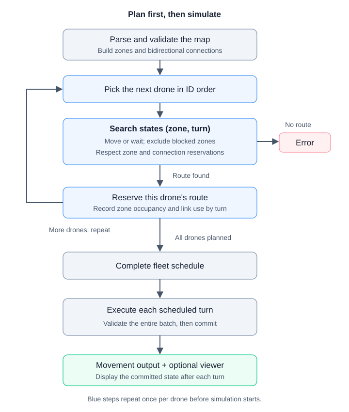
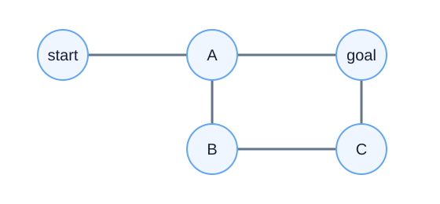

*This project has been created as part of the 42 curriculum by aakhmeto.*

# Fly-in

## Description

Fly-in moves drones from a start hub to an end hub through connected zones.
Drones can move at the same time, but zones and connections have limited
capacity. Some zones also take longer to enter.

The goal is to deliver every drone in as few simulation turns as possible.
The project follows Fly-in subject version 3.0 and includes a map parser,
a custom graph model, a route planner, a simulation engine, and a Pygame viewer.

This project is a way to learn about graphs, shortest paths, and planning
several routes that share limited space. A zone is a vertex (node), and a
connection is an undirected edge: drones can travel in either direction.
The graph theory notes at the end recap the main ideas for interview prep.

## Instructions

Requirements: Python 3.10 or newer, `make`, and a graphical display for the
optional Pygame viewer.

Install dependencies into the project virtual environment:

```bash
make install
```

Run a supplied map:

```bash
make run MAP=maps/easy/01_linear_path.txt
```

The application can also be started directly:

```bash
.venv/bin/python main.py maps/medium/02_circular_loop.txt
```

Development commands:

```bash
make lint
make debug MAP=maps/easy/01_linear_path.txt
make clean
```

`make lint` runs Flake8 and Mypy. `make clean` removes Python bytecode caches
and the Mypy cache.

## Map format and output

A map declares a positive drone count, one start hub, one end hub, ordinary
hubs, and bidirectional connections. Zone names must be unique and cannot
contain spaces or dashes. Coordinates are integers. Connections refer to
previously declared zones; reversed duplicates are also rejected.
Lines starting with `#` are comments.

Optional zone metadata includes `zone`, `color`, and `max_drones`.
Connections accept `max_link_capacity`. Ordinary zones and connections have
capacity 1 by default; start and end hubs have no occupancy limit.

Zone types:

- `normal`: entry takes one turn.
- `priority`: entry takes one turn and is preferred between equal-time routes.
- `restricted`: entry takes two turns.
- `blocked`: cannot be entered or used in a route.

For example, `maps/easy/01_linear_path.txt` contains:

```text
# Easy Level 1: Simple linear path
nb_drones: 2

start_hub: start 0 0 [color=green]
hub: waypoint1 1 0 [color=blue]
hub: waypoint2 2 0 [color=blue]
end_hub: goal 3 0 [color=red]

connection: start-waypoint1
connection: waypoint1-waypoint2
connection: waypoint2-goal
```

Running it directly produces:

```text
D1-waypoint1
D1-waypoint2 D2-waypoint1
D1-goal D2-waypoint2
D2-goal
```

Each output line represents one turn. Moving drones produce space-separated
tokens; waiting drones are omitted. Ordinary arrivals use `D<ID>-<zone>`.
Restricted departures use `D<ID>-<source>-<destination>`, followed by
`D<ID>-<destination>` on the next turn. An idle turn produces an empty line.
Delivered drones leave the simulation. Input errors report their line and
cause; an unreachable end produces a clear planning error.

## Algorithm

The parser builds the graph without a graph library. Each zone stores its
neighbors. A connection has one shared capacity, used by both directions.

Before the simulation starts, the planner finds a full route for each drone,
starting with D1, then D2, and so on. It uses Dijkstra's algorithm with a
priority queue from Python's `heapq`. Each search state is a pair:
`(zone, turn)`. From there, a drone can move to a neighbor or wait one turn.
Entering a normal or priority zone takes one turn; entering a restricted zone
takes two. Blocked zones are skipped.

The search finds the earliest possible arrival at the end. If two routes
arrive at the same time, it prefers one that visits a priority zone.
Once a route is chosen, the planner reserves its zone and connection capacity
for the required turns. The next drone must respect those reservations. It
can wait, take another path, or enter a zone as another drone leaves it.

For a restricted move, the drone departs onto the connection and arrives in the
destination zone on the next turn. The connection becomes available again on
that arrival turn. The destination is reserved for the arrival turn, rather
than the departure turn, so another drone can follow one turn behind.
Opposite-direction departures share the same connection capacity.

The search has a turn limit, so it cannot run forever on an impossible map.
The limit leaves enough time to wait at the start until earlier drones finish
and then follow a simple path to the end, if one exists.

For each turn, the simulation checks all moves before applying any of them.
Departures and arrivals happen together. If any move is invalid, the whole
turn is rejected and nothing changes. Restricted arrivals happen automatically
on the next turn. The text output and viewer show the accepted moves.

This approach is called **prioritized planning**. It matches the reference
optimum on all supplied maps, but a different drone order could give a better
result on another map. It does not guarantee the best schedule for every graph.

The planning and execution flow is:



Time matters because a zone can be full now and free later. These are different
options for the search:

```text
(A, t) -- wait one turn --------> (A, t+1)
(A, t) -- enter normal B -------> (B, t+1)
(A, t) -- enter restricted R ---> (R, t+2)
```

The restricted transition represents departure on turn `t+1` and automatic
arrival on turn `t+2`. Each transition is considered only if its required
capacity is available.

## Performance

Subject v3.0 requires at most `1.25 × optimum` turns on each of the nine
easy, medium, and hard maps. The current results match the reference optimum:

| Category | Map | Turns |
|---|---|---:|
| Easy | Linear Path | 4 |
| Easy | Simple Fork | 4 |
| Easy | Basic Capacity | 4 |
| Medium | Dead End Trap | 8 |
| Medium | Circular Loop | 10 |
| Medium | Priority Puzzle | 6 |
| Hard | Maze Nightmare | 13 |
| Hard | Capacity Hell | 16 |
| Hard | Ultimate Challenge | 26 |
| Challenger (optional) | The Impossible Dream | 43 |

## Visualization

```bash
make visualize MAP=maps/easy/01_linear_path.txt
```

For a direct launch, add `--visualize` to the Python command. The viewer prints
the same movement output as a run without graphics.

| Control | Action |
|---|---|
| Release Space | Advance one turn. |
| Resize or maximize the window | Enlarge the map; it fits the window automatically. |
| Close the window | Stop the run. |

The resizable view (minimum 960 × 640) shows the coordinate grid, connections,
colored zones, drone IDs, and the current turn. Long zone names are shortened
when space is limited. Enlarge the window to see more of each name.
Ordinary zones show `used/limit`; in compact view, drone markers occupy this
space when the zone is occupied. Start and end hubs show waiting and delivered
totals. Waiting drones remain visible, and drones sharing a position are
drawn side by side.
Restricted movements animate to the connection midpoint on departure and
from the midpoint to the destination on arrival.

Stepping through turns helps show where drones wait and which zones slow down
the rest of the fleet.

## Resources

- [Python documentation](https://docs.python.org/3/): language, typing, and
  standard library references.
- [heapq documentation](https://docs.python.org/3/library/heapq.html):
  priority queues used for route search.
- [Pygame documentation](https://www.pygame.org/docs/): rendering and window
  event handling.
- The Fly-in v3.0 subject and supplied maps: movement rules, input format,
  and reference turn counts.

AI assistance: AI was used to interpret requirements, review code
and architecture against object-oriented design principles, discuss variable,
function, and class names, and design and run tests and verification checks.

## Graph theory notes

### Vocabulary and the project model

A graph is written as `G = (V, E)`, where `V` is the set of vertices and `E`
is the set of edges. Here, vertices are zones and edges are connections.

| Term | Meaning | In Fly-in |
|---|---|---|
| Vertex / node | An individual element of a graph; the terms are synonyms. | A start hub, ordinary hub, or end hub. |
| Edge | A connection between two vertices. | A `connection:` declaration. |
| Neighbor / adjacency | Two vertices are adjacent if an edge joins them. | A zone reachable through one connection. |
| Degree | Number of edges incident to a vertex in an undirected graph. | Number of connections at a hub. |
| Walk / path | A walk follows edges and may revisit vertices; a simple path does not repeat vertices. | A drone route may revisit a zone or wait there. |
| Cycle | A closed path with no repeated vertices except the first and last. | A loop in the map; search must handle it without running forever. |
| Undirected / directed graph | Undirected edges allow both directions; directed edges have a specified direction. | Map connections are undirected; search transitions move forward in time. |
| Weight / cost | A numerical cost associated with traversal. | Entry takes one or two turns, depending on the destination. |
| Capacity | A limit on simultaneous use, distinct from traversal cost. | `max_drones` limits occupancy; `max_link_capacity` limits departures per turn. |
| Connected graph | Every pair of vertices is joined by a path. | The whole map need not be connected; a usable start-to-end route is required. |
| Connected component | A maximal set of mutually reachable vertices. | Isolated parts of a map form separate components. |
| Bridge | An edge whose removal increases the number of connected components. | A connection that may be the only access to another part of the map. |
| Articulation point | A vertex whose removal increases the number of connected components. | A hub whose loss can disconnect a route. |
| Biconnected graph | A connected graph with at least three vertices and no articulation point. | A different property from bidirectional connections; not required here. |
| Adjacency list | A representation storing each vertex's neighbors. | The custom graph exposes neighbors for route exploration. |

Check connectivity after removing blocked zones. A connected input map can
still have no usable route from start to end. Also, an undirected connection
does not imply equal travel times: entry costs depend on the destination zone.



In this example, `A` has degree 3. The vertices `A, goal, C, B` form a cycle.
The edge `start-A` is a bridge, and `A` is an articulation point. Every edge
can be traversed in both directions, but the graph is not biconnected.

### Algorithms to remember

| Algorithm | Typical use | Relevance here |
|---|---|---|
| BFS (breadth-first search) | Reachability and shortest paths when every edge has equal cost. | Useful for connectivity checks. Plain BFS on map zones does not account for two-turn entries and reservations. |
| DFS (depth-first search) | Reachability, components, and cycle detection with suitable bookkeeping. | Useful for structural analysis; does not generally find a minimum-cost route. |
| Dijkstra | Shortest paths with nonnegative edge weights, usually using a priority queue. | Used over `(zone, turn)` states with reservations from earlier drones. |
| A* | Shortest-path search guided by a lower-bound heuristic; a consistent heuristic supports standard graph-search guarantees. | A possible alternative, not implemented. Map coordinates alone do not give an admissible travel-time estimate: long connections can still cost one turn. |
| Bellman–Ford | Shortest paths with negative edge weights and detection of reachable negative cycles. | Negative travel costs do not occur here, so its extra capability is unnecessary. |
| Kruskal / Prim | Minimum spanning tree: connect all vertices of a connected undirected weighted graph with minimum total edge weight. | A different objective from routing drones; a spanning tree can discard useful parallel routes. |
| Maximum flow | Maximum throughput between a source and sink under edge capacities. | Related to fleet routing, but static flow alone does not model arrival times or zone occupancy. A time-expanded network can express these constraints. |

For standard adjacency-list implementations, BFS and DFS take `O(V + E)`
time; Dijkstra with a binary heap takes `O((V + E) log V)`. In this planner,
those bounds must be applied to the searched state graph, not just the map:
with a time horizon `H`, up to `V × (H + 1)` zone-time states can exist, and
a separate search is performed for each drone.

### Interview takeaways

- **Shortest path versus fleet schedule:** the fastest route for one drone
  can consume capacity that would help several others arrive sooner.
- **State design:** visiting zone `A` on turn 3 and on turn 4 represents two
  different possibilities. A visited set containing only zone names loses this
  distinction.
- **Cost versus capacity:** a one-turn route can still be a bottleneck when
  only one drone may use it per turn.
- **Topology versus geometry:** coordinates position the visualization;
  connections determine reachability, and zone types determine travel time.
- **Local versus global optimality:** Dijkstra finds the earliest route for
  the current drone given existing reservations. It does not make the chosen
  drone order globally optimal.
